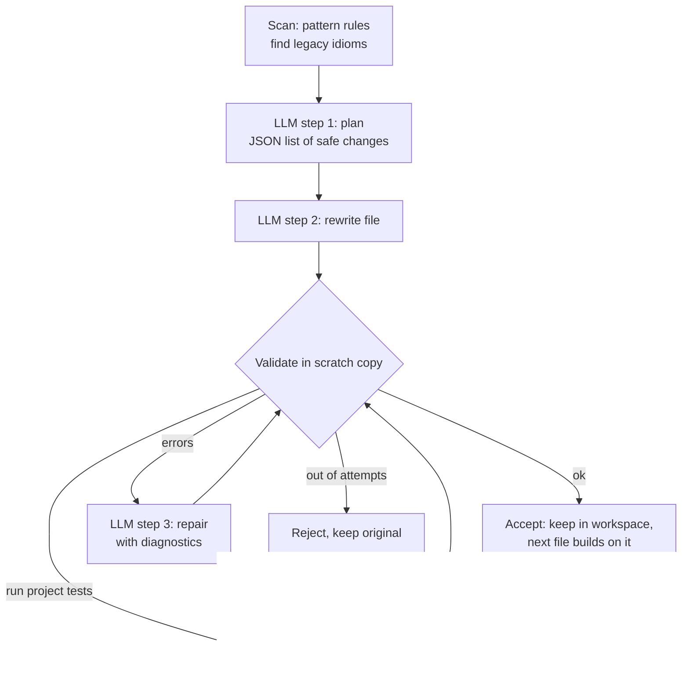

# CodeRenew

A command-line tool that modernizes legacy C++ with an LLM, and only keeps a change if
the compiler and your own test suite agree it's safe.

```bash
coderenew scan examples/legacy_inventory
coderenew modernize examples/legacy_inventory --test-cmd "make test"
```

## Why

LLMs are good at mechanical modernization (`NULL` to `nullptr`, `typedef` to `using`,
`sprintf` into a bounded buffer...), but they also make confident mistakes: code that
doesn't compile, or compiles and quietly changes behavior. CodeRenew treats every
rewrite as untrusted until it passes three gates:

1. **Compiler**: the file must compile with `-Wall -Wextra` at the target standard.
2. **Your tests**: the project's test command must pass with the new file in place
   (run in a scratch copy). The tests must also pass *before* any change, otherwise
   there is no baseline and the run stops.
3. **No regression in idioms**: the rewrite can't have more legacy findings than the
   original.

If a gate fails, the error output (compiler diagnostics or failing test output) goes
back to the model for a bounded number of repair attempts. Rejected rewrites are never
written.

## How it works



Files are processed in order inside one workspace, so a header modernized first is
what the `.cpp` files are compiled against next. Your project directory is only
written to with `--apply`; otherwise you get `coderenew-out/changes.patch`
(apply with `git apply`) and a `report.md` listing each file's plan, status and
findings before and after.

### What the scanner looks for

| Rule | Example | Suggestion |
|---|---|---|
| `null-macro` | `p == NULL` | `nullptr` |
| `raw-new` / `raw-delete` | `new Item`, `delete[] items_` | RAII, `std::make_unique`, containers |
| `c-style-cast` | `(double)n` | `static_cast` |
| `typedef` | `typedef std::vector<T> List;` | `using List = ...` |
| `define-constant` | `#define MAX 100` | `constexpr` |
| `auto-ptr` | `std::auto_ptr<T>` | `std::unique_ptr` |
| `malloc-free` | `malloc(n)` | containers / smart pointers |
| `unsafe-c-string` | `sprintf`, `strcat`, `strcpy` | `std::string`, `snprintf` |
| `index-loop` | `for (int i = 0; i < n; i++)` | range-based `for` |
| `private-copy-ctor` | `A(const A&);` (undefined) | `= delete` |
| `throw-spec` | `void f() throw()` | `noexcept` |

The scanner blanks out comments and string literals first, so `"NULL"` in a string or
`// new` in a comment is not reported. It's a pattern matcher, not a C++ parser, so
it guides the model and measures progress; the compiler and tests decide correctness.

## Tech stack

Python 3.11+, OpenAI API, g++ / clang++, pytest, Ruff, GitHub Actions
(tested with both compilers).

## Run it locally

Needs Python 3.11+, `make`, and g++ or clang++.

```bash
git clone https://github.com/Nickbhalala/CodeRenew.git && cd CodeRenew
python -m venv .venv && source .venv/bin/activate
pip install -e ".[dev]"
```

Scan (no API key needed):

```bash
coderenew scan examples/legacy_inventory
```

Modernize (needs `OPENAI_API_KEY`; copy `.env.example` to `.env`):

```bash
coderenew modernize examples/legacy_inventory --test-cmd "make test"
coderenew modernize examples/legacy_inventory inventory.h inventory.cpp --test-cmd "make test" --apply
```

Run the tests (the LLM is replaced by scripted responses; g++ and make are real):

```bash
pytest
```

## Configuration

| Setting | Default | Purpose |
|---|---|---|
| `OPENAI_API_KEY` | (required for `modernize`) | OpenAI credentials |
| `CODERENEW_MODEL` | `gpt-4o` | Model for all steps |
| `--std` | `c++17` | Target standard for the compile check |
| `--test-cmd` | none | Command that must pass before and after each change |
| `--max-repairs` | `2` | Repair attempts per file |
| `--apply` | off | Write accepted files back to the project |

Without `--test-cmd` only the compiler gate runs, so behavior changes can slip through;
use it whenever the project has tests.

## Project structure

```text
coderenew/
  scanner.py     legacy idiom rules; comment/string-aware
  validate.py    compile check, test runner, scratch-copy validation
  chain.py       plan -> rewrite -> validate -> repair; report and patch output
  prompts.py     prompt templates
  llm.py         OpenAI client and scripted test double
  cli.py         `coderenew scan` / `coderenew modernize`
examples/legacy_inventory/   pre-C++11 demo project with tests and Makefile
tests/                        scanner, validation, chain and CLI tests (+ fixtures)
```

## What I'd improve next

- Use `compile_commands.json` so the compile gate uses the project's real flags and
  include paths.
- Replace pattern rules with clang-tidy's `modernize-*` checks where available, and use
  them as a second opinion on the model's output.
- Chunk large files by function so big translation units can be processed.
- Run sanitizers (ASan/UBSan) in the test gate to catch memory errors introduced by
  ownership changes.
- An evaluation set of legacy snippets to compare models and prompt versions by
  acceptance rate.

## About this project

Built by Nikhil Bhalala with AI assistance (Claude by Anthropic) for code generation and
review. The example project is written for this repository.

## License

[MIT](LICENSE)
